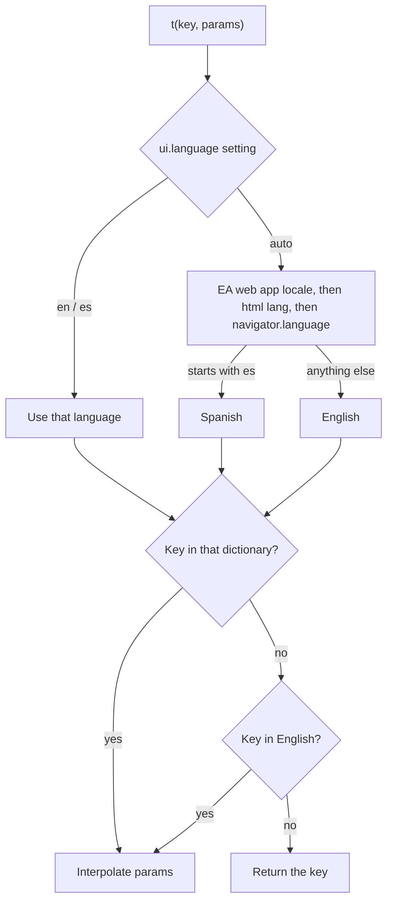
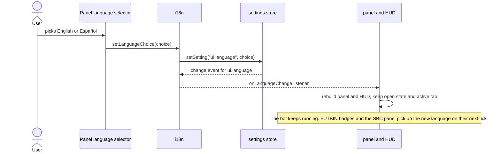
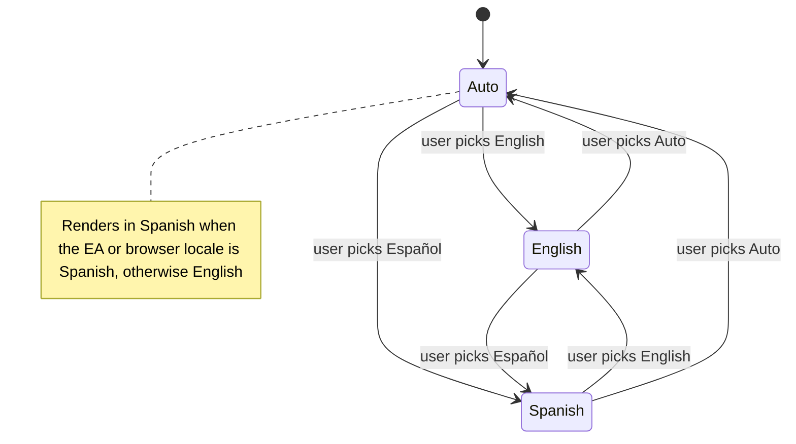

# i18n

Interface translations for MagicBuyer. Every user-visible string (panel, HUD, FUTBIN integrations, journal, notifications) is resolved through `t()` in the active language. Supported languages: English (`en`, reference) and Spanish (`es`, Mexican Spanish).

## Public API

All exports live in `app/i18n/index.js`.

| Export | Description |
| --- | --- |
| `t(key, params?)` | Returns the text for `key` in the active language. Placeholders use braces: `{name}`. |
| `getLanguage()` | Language used to render text: `"en"` or `"es"`. |
| `getLanguageChoice()` | Stored preference: `"auto"`, `"en"` or `"es"`. |
| `setLanguageChoice(choice)` | Saves the preference (`ui.language` setting). Invalid values fall back to `"auto"`. |
| `onLanguageChange(fn)` | Subscribes to preference changes. Returns an unsubscribe function. |
| `numberLocale()` | Intl locale for numbers, dates and times: `"en-US"` or `"es-MX"`. |
| `LANGUAGES`, `LANGUAGE_CHOICES` | Supported languages, and the same list with `"auto"`. |

```js
import { t, numberLocale } from "../i18n";

log.buy(t("engine.log.bought", { name: item.name, price: formatCoins(price) }));
new Date(time).toLocaleTimeString(numberLocale());
```

## Configuration

The language preference is the `ui.language` setting (default `"auto"`), chosen from the selector in the panel header. In `auto` mode the language comes from the EA web app locale, then the `<html lang>` attribute, then the browser language. Any Spanish locale (`es`, `es-MX`, `es-ES`…) uses Spanish; everything else uses English.

## Adding or changing strings

- Dictionaries live in `locales/<language>/<namespace>.js`, one namespace per area: `core`, `engine`, `pages`, `prices`, `ui`. Keys are flat and prefixed with their namespace (`pages.buy.maxPerSearch.label`).
- Add every key to **both** `en` and `es`. A key missing in Spanish falls back to English; a key missing everywhere renders as the key itself, which makes it easy to spot.
- Call `t()` at render or call time, never in a module-level constant: a constant is evaluated once at load and would not follow a language switch.
- Never translate values used as logic: persisted setting values, enum and status values, storage keys, or text matched against FUTBIN or EA pages.

## Design

### Resolving a string



### Switching language



## Diagrams

### Language preference states


